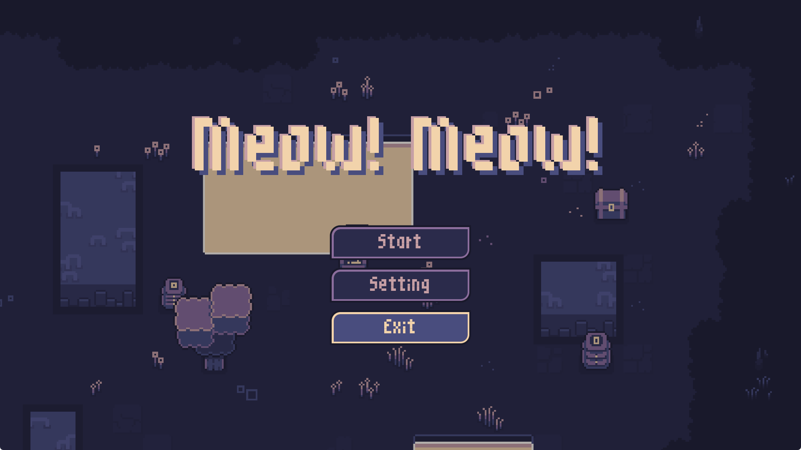
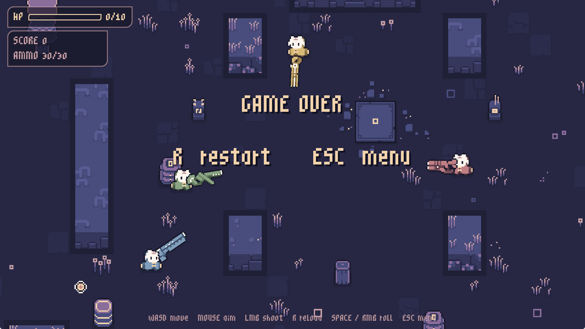

# Meow! Meow!

A 2D pixel-art shooter. Play as a heroine and survive waves of cat enemies with power-ups and explosive barrels.

## How to Play

Choose Luna, Iris, or Nora, then clear each wave to face more enemies and earn a higher score. Dodge incoming fire, reload your weapon, and roll to avoid damage. The game ends when your health reaches zero.

- **Red cats** deal extra bullet damage.
- **Green cats** move as fast as the player.
- **Yellow cats** fire more frequently.
- **Blue cats** take more hits to defeat.

Each wave brings three randomly placed power-ups: **Health** restores full health, **Time** slows the game for 10 seconds, and **Speed** doubles your movement speed for 10 seconds.

Shoot explosive barrels to trigger blasts and chain reactions. Barrels return each wave. Step through a portal to teleport to the other portal.

## Controls

| Action | Input |
| --- | --- |
| Move | WASD / Arrow keys |
| Aim | Mouse |
| Shoot | Left mouse button (LMB) |
| Reload | R |
| Roll | Space / Right mouse button (RMB) |
| Restart after game over | R |
| Return to menu | Esc |
| Choose a character | Left / Right arrows, then Enter |

## Screenshots

**Main menu**



**Game over**



## Run Locally

Built with Rust and Bevy. With the Rust toolchain installed, run:

```bash
cargo run
```
